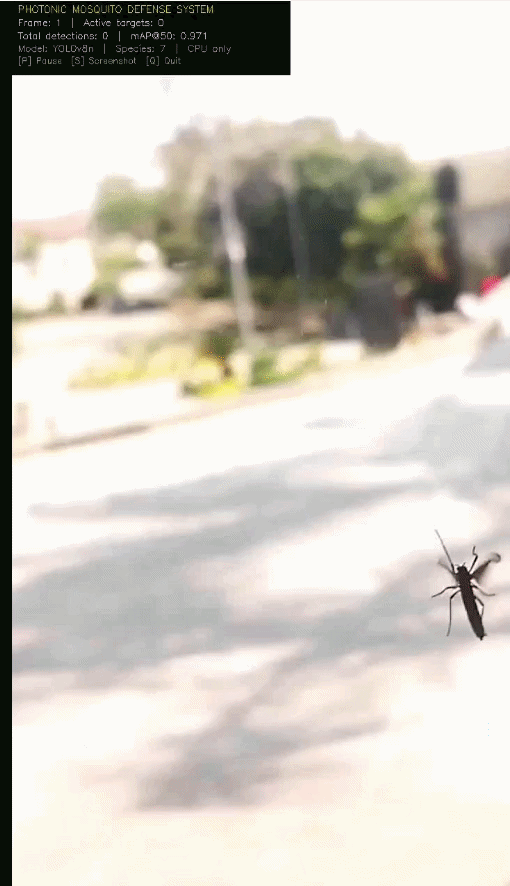

# 🦟 Photonic Mosquito Defense System

> An AI-powered, real-time mosquito species detection and targeting system built for real-world vector control applications.

## Motivation

In 2018, I spent two months bedridden with malaria in Nigeria. 
That experience gave me a direct understanding of what vector-borne 
disease costs a person — and motivated me to explore whether precision 
engineering could offer a fundamentally different approach to mosquito 
control: one that is targeted, chemical-free, and intelligent.

This system is capable of identifying and tracking 7 classes, including *Anopheles gambiae* — the primary malaria vector in sub-Saharan Africa.

## 🚀 Features & Capabilities

The system is currently in **Phase 1**, featuring a fully functional software prototype that performs the following in real-time:

- **Real-Time Species Classification:** Detects 6 mosquito species + non-mosquito objects using a custom-trained YOLOv8 model.
- **Multi-Object Tracking:** Assigns persistent IDs to mosquitoes as they move across video frames, locking onto a stabilized classification using temporal smoothing.
- **Trajectory Prediction:** Calculates flight velocity and predicts future intercept locations based on coordinate history.
- **Targeting HUD & Logging:** Overlays a simulated targeting reticle on active targets and logs all detection events, confidences, and intercept coordinates to a CSV file.
- **Auto-Capture:** Automatically saves high-resolution screenshots the moment a target species classification is locked.

### Species Detected

| Species | Medical Relevance |
|---|---|
| **Anopheles gambiae** | Primary malaria vector (sub-Saharan Africa) |
| **Anopheles funestus** | Major malaria vector |
| **Anopheles other** | Secondary malaria vectors |
| **Aedes** | Dengue, Zika, Yellow Fever |
| **Culex** | Lymphatic filariasis, West Nile |
| **Mansonia** | Filariasis, encephalitis |
| **Non-mosquito** | Negative class (flies, background noise) |

## 🧠 System Architecture

The current detection pipeline runs synchronously:
1. **Video Input** → Stream captured via OpenCV.
2. **YOLOv8 Detector** → Identifies bounding boxes and initial classifications.
3. **Tracker & Smoother** → YOLO tracking + history-based stabilization for consistent ID and species locks.
4. **Trajectory Predictor** → Calculates vector intercept coordinates from the recent flight trail.
5. **HUD & Logger** → Renders the visual targeting reticle and exports structured event data.

## 🛠️ Tech Stack

- **Core:** Python 3.x
- **Computer Vision:** YOLOv8 (Ultralytics), OpenCV
- **Data Math:** NumPy, SciPy
- **(Planned):** FilterPy (Kalman filtering), ROS 2

## 📊 Dataset & Model Details

- **Dataset:** Species-labeled mosquito dataset from Roboflow Universe (License: CC BY 4.0).
- **Size:** 2,719 Training, 473 Validation, 806 Test instances.
- **Model:** YOLOv8n (Nano) trained for rapid real-time inference.
- **Performance:** Evaluated test set performance with high mAP accuracy across most classes.

## 🗺️ Roadmap

- [x] **Phase 1:** Software prototype — real-time detection, tracking, and simulated targeting.
- [ ] **Phase 2 (3–6 months):** ROS 2 simulation bridge, embedded system design.
- [ ] **Phase 3 (Future):** Hardware integration, deployment on Raspberry Pi / Jetson Nano, and physical optical targeting mechanics.
- [ ] **Additional:** Wing-beat frequency classifier (audio integration).

## 👤 Author

**Madueke Martins**
